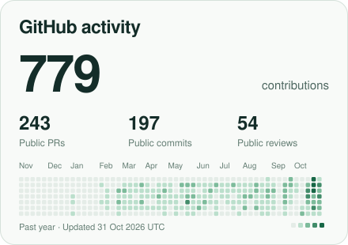
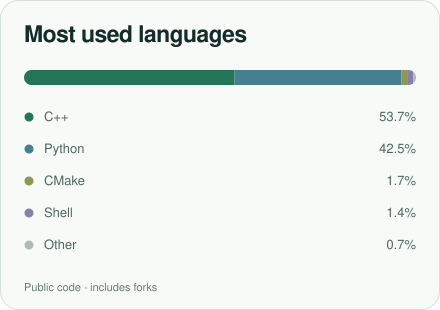

  

<picture>
  <source media="(prefers-color-scheme: dark)" srcset="./assets/hero-dark.svg">
  
</picture>

 

  <a href="https://github.com/lwDavid?tab=overview">
    <picture>
      <source media="(prefers-color-scheme: dark)" srcset="./assets/activity-dark.svg">
      
    </picture>
  </a>
  &nbsp;&nbsp;
  <a href="https://github.com/lwDavid?tab=repositories">
    <picture>
      <source media="(prefers-color-scheme: dark)" srcset="./assets/languages-dark.svg">
      
    </picture>
  </a>

